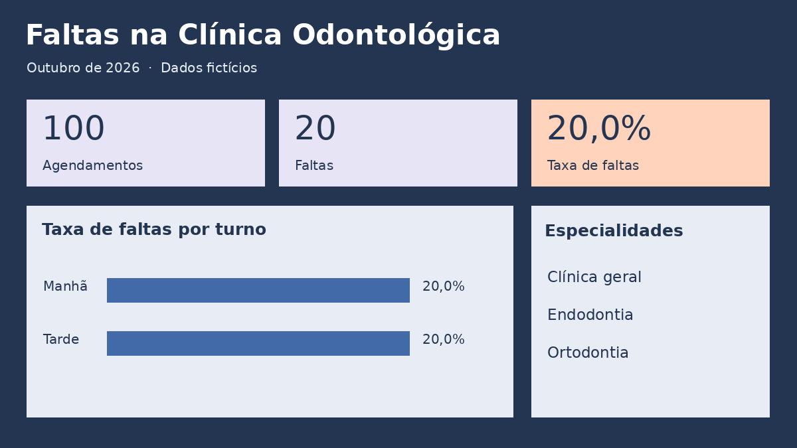

# Faltas na clínica odontológica

Projeto de portfólio realizado com SQLite, Power BI e DAX. O relatório explora como as faltas variam por turno e especialidade em uma agenda fictícia de outubro de 2026.



## Resultados

Dos 100 agendamentos, 20 terminaram em falta. Manhã e tarde registraram 10 faltas em 50 agendamentos cada (20%). O filtro por especialidade revela diferenças que a média esconde. Em Endodontia, foram 2 faltas em 17 agendamentos de manhã (11,8%) e 4 em 16 à tarde (25%). Os dados são simulados e servem para demonstrar a análise.

## Abrir o painel

Extraia o ZIP inteiro em uma pasta e abra **Clinica.pbip** no Power BI Desktop com suporte a projetos PBIP/PBIR. Mantenha as pastas **Clinica.Report** e **Clinica.SemanticModel** ao lado dele. Na primeira abertura, clique em **Página Inicial → Atualizar** para carregar os dados. O modelo inclui as seis linhas do resumo SQL e dispensa configurar o caminho do CSV. Selecione uma especialidade para atualizar os três indicadores e o gráfico. Limpe o filtro para voltar ao total.

## Reproduzir a análise

Execute **analise.sql** em um banco SQLite vazio. O script gera os 100 registros, agrupa por turno e especialidade e conta as faltas em cada grupo. O resultado está em **resumo_agendamentos.csv**. No Power BI, a medida divide a soma das faltas pela soma dos agendamentos no contexto do filtro.


```dax
Taxa de faltas = DIVIDE([Faltas], [Agendamentos])
```
